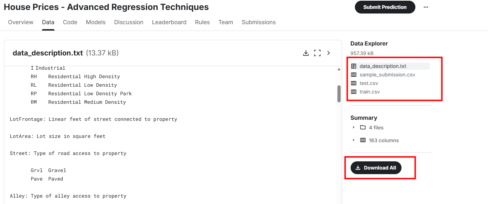
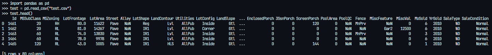

# 01 - latihan data collection
- https://www.kaggle.com/competitions/house-prices-advanced-regression-techniques/data



## 02 - latihan data loading
```py3
import pandas as pd
test = pd.read_csv("test.csv") # load data dari file test.csv
test.head() # menampilkan 5 baris pertama data
```



```py
train = pd.read_csv("train.csv")
train.head()
```

## 03 - latihan data cleaning
```py3
train.info() # melihat informasi data

# Menampilkan statistik deskriptif dari dataset
train.describe(include="all")

# Memeriksa jumlah nilai yang hilang di setiap kolom
missing_values = train.isnull().sum()
missing_values[missing_values > 0]
```

#### Mengatasi Missing Value
```py3
less = missing_values[missing_values < 1000].index
over = missing_values[missing_values >= 1000].index
```

numeric
```py3
# Contoh mengisi nilai yang hilang dengan median untuk kolom numerik
numeric_features = train[less].select_dtypes(include=['number']).columns
train[numeric_features] = train[numeric_features].fillna(train[numeric_features].median())
```
> Secara singkat kode di atas memiliki dua fungsi utama yaitu sebagai berikut.
Baris pertama memilih nama-nama kolom dari DataFrame train yang memiliki tipe data numerik dari subset kolom yang ditentukan oleh less.
Baris kedua kemudian mengisi semua nilai yang hilang (NaN) pada kolom-kolom numerik tersebut dengan nilai median dari masing-masing kolom.

string
```py3
# Contoh mengisi nilai yang hilang dengan mode untuk kolom kategori
kategorical_features = train[less].select_dtypes(include=['object']).columns

for column in kategorical_features:
    train[column] = train[column].fillna(train[column].mode()[0])

```
> Kode di atas akan melakukan pengulangan pada setiap kolom yang berisi data kategori dalam DataFrame train. Selanjutnya, setiap kolom kategori akan melakukan proses pergantian untuk semua nilai yang hilang (NaN) dengan nilai modus dari kolom tersebut. Hasil akhirnya adalah semua kolom kategori dalam DataFrame train tidak lagi memiliki nilai yang hilang (NaN) karena semua NaN telah diisi dengan nilai modus dari kolom masing-masing.

Menghapus Kolom dengan Banyak Nilai yang Hilang:jika ada kolom dengan terlalu banyak nilai yang hilang, kita bisa mempertimbangkan untuk menghapusnya
```py3
# Menghapus kolom dengan terlalu banyak nilai yang hilang
df = train.drop(columns=over)
```

cek kembali missing value
```py3
missing_values = df.isnull().sum()
missing_values[missing_values > 0]
```

#### Mengatasi Outliers
mengatasi outlier bisa dilakukan dengan beberapa cara, seperti:
1. **Menghapus Outliers:** Hapus baris yang mengandung outliers.
2. **Transformasi Data:** Gunakan transformasi logaritmik atau Box-Cox untuk mengurangi dampak outliers.
3. **Imputasi:** Ganti outliers dengan nilai yang lebih representatif, seperti median.

periksa terlebih dahulu apakah dataset yang digunakan memiliki outlier atau tidak
```py3
import pandas as pd
import seaborn as sns
import matplotlib.pyplot as plt

for feature in numeric_features:
    plt.figure(figsize=(10, 6))
    sns.boxplot(x=df[feature])
    plt.title(f'Box Plot of {feature}')
    plt.show()
```


```py3
# Contoh sederhana untuk mengidentifikasi outliers menggunakan IQR
Q1 = df[numeric_features].quantile(0.25)
Q3 = df[numeric_features].quantile(0.75)
IQR = Q3 - Q1

# Filter dataframe untuk hanya menyimpan baris yang tidak mengandung outliers pada kolom numerik
condition = ~((df[numeric_features] < (Q1 - 1.5 * IQR)) | (df[numeric_features] > (Q3 + 1.5 * IQR))).any(axis=1)
df_filtered_numeric = df.loc[condition, numeric_features]

# Menggabungkan kembali dengan kolom kategorikal
categorical_features = df.select_dtypes(include=['object']).columns
df = pd.concat([df_filtered_numeric, df.loc[condition, categorical_features]], axis=1)
```

#### Normalisasi dan Standardisasi Data
normalisasi dan standardisasi data bertujuan untuk mengubah skala fitur numerik agar berada dalam rentang yang sama atau memiliki distribusi tertentu. Berikut adalah contoh cara melakukan normalisasi dan standardisasi menggunakan Scikit-Learn:

```py3
from sklearn.preprocessing import StandardScaler

# Standardisasi fitur numerik
scaler = StandardScaler()
df[numeric_features] = scaler.fit_transform(df[numeric_features])
```

```py3
# Histogram Sebelum Standardisasi
plt.figure(figsize=(12, 5))
plt.subplot(1, 2, 1)
sns.histplot(train[numeric_features[3]], kde=True)
plt.title("Histogram Sebelum Standardisasi")

# Histogram Setelah Standardisasi
plt.subplot(1, 2, 2)
sns.histplot(df[numeric_features[3]], kde=True)
plt.title("Histogram Setelah Standardisasi")
```

#### Menangani Duplikasi Data
menangani duplikasi data dapat dilakukan dengan menggunakan metode `drop_duplicates()` dari pandas. Berikut adalah contoh cara menghapus duplikasi data dalam DataFrame:

```py3
# Mengidentifikasi baris duplikat
duplicates = df.duplicated()

print("Baris duplikat:")
print(df[duplicates])

# Menghapus baris duplikat
df = df.drop_duplicates()

print("DataFrame setelah menghapus duplikat:")
print(df)
```

#### Mengonversi Tipe Data
mengonversi tipe data dapat dilakukan dengan menggunakan metode `astype()` dari pandas. Berikut adalah contoh cara mengonversi tipe data kolom dalam DataFrame:

```py3
# sebelum kita melakukan encoding, silakan perhatikan data kategorikal yang ada pada dataset
category_features = df.select_dtypes(include=['object']).columns
df[category_features]

df_one_hot = pd.get_dummies(df, columns=category_features)
df_one_hot.head()
```

Label Encoding
```py3
from sklearn.preprocessing import LabelEncoder

# Inisialisasi LabelEncoder
label_encoder = LabelEncoder()
df_lencoder = pd.DataFrame(df)

for col in category_features:
    df_lencoder[col] = label_encoder.fit_transform(df[col])

# Menampilkan hasil
df_lencoder
```

#### Perbandingan One-Hot Encoding vs Label Encoding

| Kriteria | One-Hot Encoding | Label Encoding |
|----------|------------------|---------------|
| **Kelebihan** | - Tidak mengasumsikan urutan/hierarki antar kategori.<br>- Setiap kategori menjadi kolom terpisah (0/1), tidak ada hubungan numerik.<br>- Cocok untuk data nominal.<br>- Model sensitif skala (misal regresi linier) lebih cocok dengan ini. | - Mudah diimplementasikan.<br>- Tidak menambah jumlah kolom (hemat memori).<br>- Cocok untuk data ordinal (ada urutan jelas). |
| **Kekurangan** | - Dapat menghasilkan dimensi sangat tinggi jika kategori banyak (curse of dimensionality).<br>- Hasilnya sparse matrix (banyak 0), bisa memperlambat pelatihan.<br>- Tidak praktis untuk fitur dengan ribuan kategori. | - Mengasumsikan urutan/hierarki antar kategori (bisa salah untuk data nominal).<br>- Bisa memperkenalkan bias numerik.<br>- Kurang cocok untuk fitur dengan banyak kategori. |
