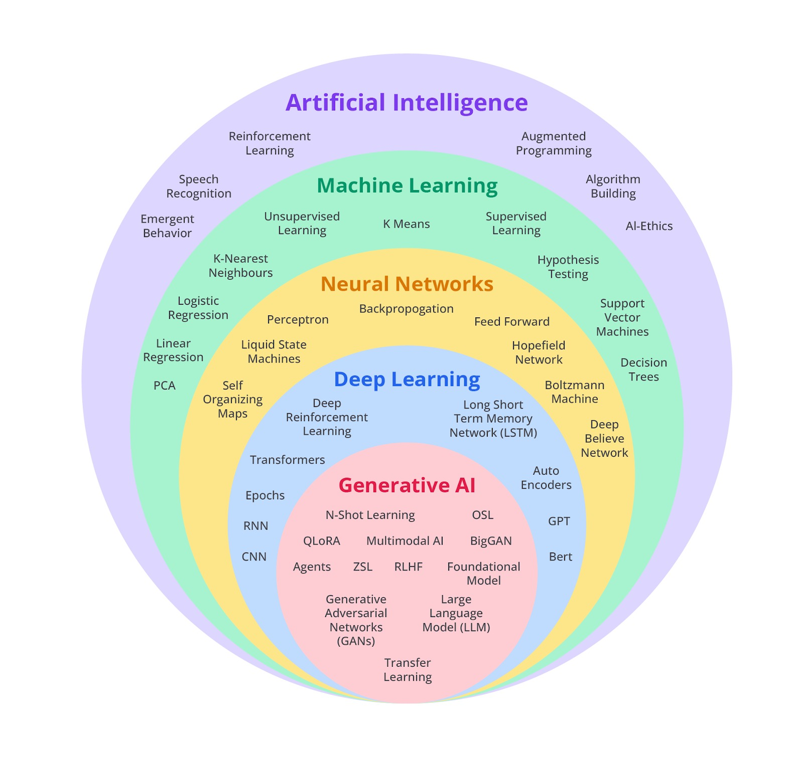
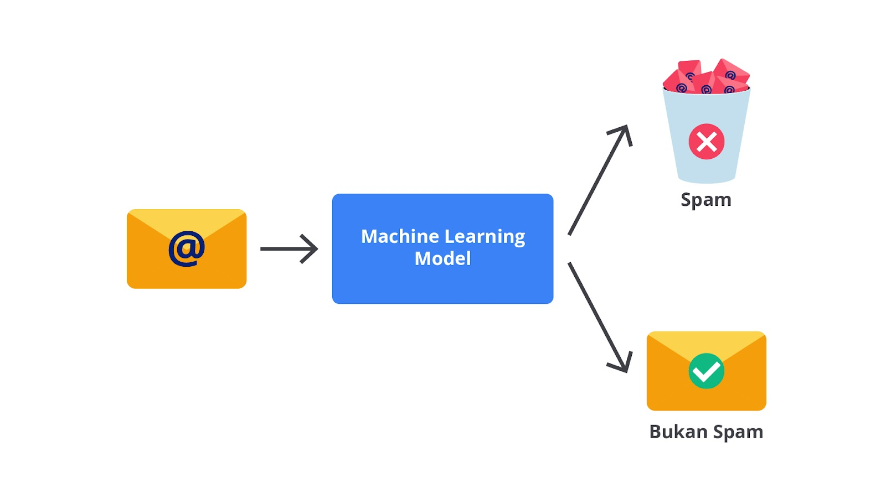
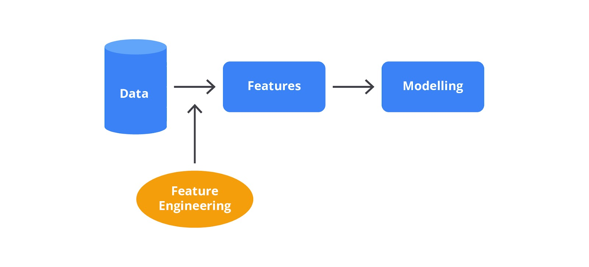
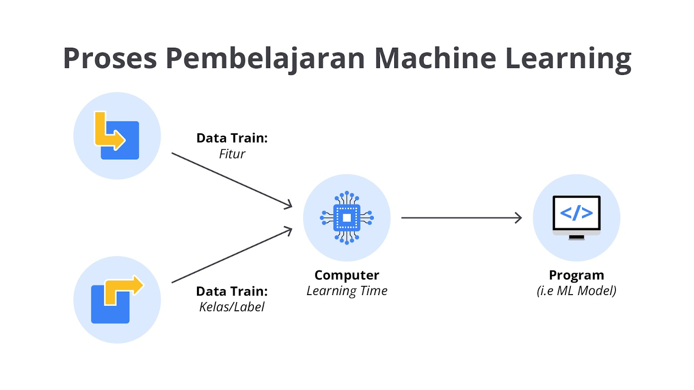
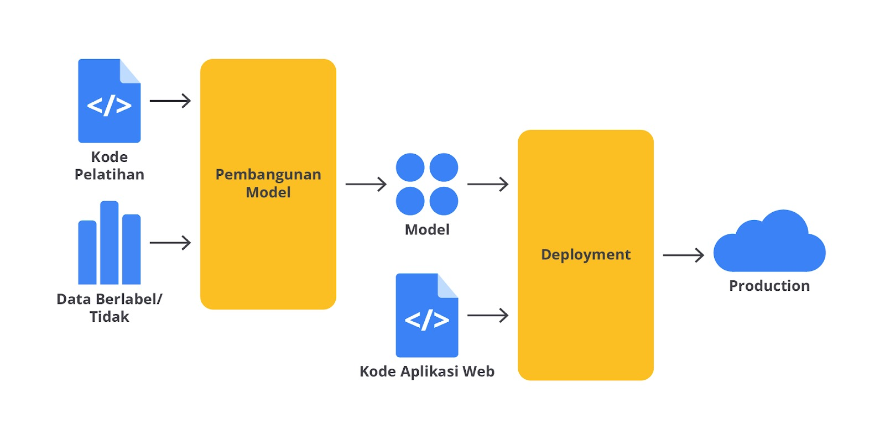

# Hi, Machine Learning!
## A. Pengantar Machine Learning
##### 1. Perkembangan Machine Learning
- Machine learning (ML) berkembang pesat dalam beberapa dekade terakhir.
- ML menjadi bagian penting dalam inovasi teknologi modern dan revolusi industri 4.0.
- ML memungkinkan sistem bekerja lebih efisien dan membuka peluang baru di berbagai sektor.

##### 2. Definisi Machine Learning
- Istilah “machine learning” dipopulerkan oleh Arthur Samuel (1959).
- Definisi: “Field of study that gives computers the ability to learn without being explicitly programmed.”
- ML memungkinkan komputer belajar dari data, bukan dari aturan yang ditulis manual.

##### 3. Posisi Machine Learning dalam Taksonomi AI

1. **Artificial Intelligence (AI)**
Bidang luas tentang membuat mesin dapat berpikir dan bertindak cerdas.

2. **Machine Learning (ML)**
Cabang AI yang membuat komputer belajar dari data.

3. **Neural Network (NN)**
Model matematika yang meniru cara kerja otak manusia.

4. **Deep Learning (DL)**
Cabang ML yang menggunakan neural network bertingkat (deep) untuk memahami data kompleks.

5. **Generative AI (GenAI)**
Cabang AI untuk membuat konten baru seperti teks, gambar, musik, dan video.

##### 4. Paradigma Pemrograman Tradisional vs Machine Learning
**Pemrograman Tradisional:**
- Input = aturan manual + data, menghasilkan output.
- Menggunakan aturan eksplisit (mis. if/else).
- Cocok untuk masalah sederhana.
- Mulai tidak efektif ketika kasus makin kompleks.

**Contoh:**
Klasifikasi aktivitas berdasarkan kecepatan:
- < 4 km/jam → BERJALAN
- 4–12 km/jam → BERLARI
- 12 km/jam → BERSEPEDA

> Menambah aktivitas seperti bermain basket membuat aturan jadi sangat rumit.

##### 5. Paradigma Machine Learning
- ML tidak memerlukan aturan manual.
- Data + label diberikan ke model → model belajar pola secara otomatis.
- Cocok untuk masalah kompleks seperti deteksi aktivitas fisik, pengenalan gambar, atau pemrosesan bahasa.

> Contoh: Sistem ML bisa belajar membedakan berjalan, berlari, bersepeda, dan bermain basket berdasarkan pola pada data tanpa aturan manual.

##### 6. Konsep Data dan Label
- Data = informasi input (mis. kecepatan, sensor gerak, gambar).
- Label (rules) = hal yang ingin diprediksi (mis. aktivitas: berjalan, berlari, dll.).
- Model ML mempelajari hubungan antara data dan label untuk membuat prediksi.

---

## B. Komponen Utama dalam Machine Learning
##### 1. Data
- Merupakan bahan dasar ML.
- Terdiri dari fitur (variabel input) dan label (output yang ingin diprediksi).
- Harus bersih, relevan, dan representatif.

> Contoh: Gambar bunga iris dengan label jenis spesies.

##### 2. Algoritma
- Metode atau prosedur yang digunakan untuk melatih model menggunakan data.
- Setiap algoritma punya cara belajar dan teknik optimasi berbeda.

> Contoh: Gradient Descent untuk optimasi parameter.

##### 3. Model
- Hasil dari proses belajar data oleh algoritma.
- Digunakan untuk prediksi atau klasifikasi.

> Contoh: Regresi linier, Decision Tree, Neural Network.

##### 4. Feature Engineering
- Proses mengubah data mentah menjadi fitur yang lebih informatif.
- Meliputi pemilihan, transformasi, atau pembuatan fitur baru.

> Contoh: Ekstraksi kata dari teks dalam analisis sentimen.

##### 5. Training
- Proses model belajar dari data latih untuk meminimalkan kesalahan.
- Biasanya dibagi menjadi data latih dan data validasi.

> Contoh: Melatih model regresi untuk memprediksi harga rumah.

##### 6. Evaluation
- Mengukur performa model menggunakan data uji.
- Menggunakan metrik seperti akurasi, precision, recall, F1-score.

> Contoh: Evaluasi klasifikasi email spam dengan confusion matrix.

##### 7. Hyperparameter Tuning
- Menyetel parameter di luar proses pelatihan yang memengaruhi performa model.
- Dilakukan manual atau otomatis.

> Contoh: Mengatur jumlah pohon di Random Forest.

##### 8. Deployment
- Tahap menerapkan model ke lingkungan nyata/produksi.
- Model digunakan oleh aplikasi untuk membuat prediksi secara langsung.

> Contoh: Integrasi model prediksi harga saham ke aplikasi trading.

---

## C. Jenis-Jenis Machine Learning
##### 1. Supervised Learning
- Menggunakan data berlabel (ada input dan output yang diketahui).
- Tujuan: mempelajari hubungan antara fitur (input) dan label (output).
- Cara kerja seperti murid belajar dari guru — model diberi contoh yang benar.
- Contoh kasus:
  - Prediksi harga rumah (fitur: ukuran, kamar, lokasi → label: harga).
  - Klasifikasi email spam.

> Contoh: Prediksi harga rumah

| Luas (m²) | Jumlah Kamar | Lokasi  | Harga (Label) |
| --------- | ------------ | ------- | ------------- |
| 120       | 3            | Jakarta | 1.800.000.000 |
| 90        | 2            | Bekasi  | 950.000.000   |
| 150       | 4            | Tangsel | 2.200.000.000 |
| 70        | 2            | Depok   | 650.000.000   |

- ✔ Ada input (luas, kamar, lokasi)
- ✔ Ada output label (harga)

##### 2. Unsupervised Learning
- Menggunakan data tanpa label (hanya fitur).
- Tujuan: menemukan pola tersembunyi, struktur, atau pengelompokan dalam data.
- Model mencari pola sendiri tanpa arahan.
- Contoh teknik: clustering, dimensionality reduction.
- Contoh kasus:
  - Pengelompokan mobil berdasarkan merek & jarak tempuh.
  - Segmentasi pelanggan.

> Contoh: Clustering pelanggan

| Pengeluaran Bulanan | Frekuensi Belanja | Umur | (Tidak Ada Label) |
| ------------------- | ----------------- | ---- | ----------------- |
| 3.5 juta            | 12x               | 25   | —                 |
| 1.2 juta            | 5x                | 40   | —                 |
| 6.1 juta            | 15x               | 30   | —                 |
| 800 ribu            | 3x                | 50   | —                 |

- ✔ Model akan cari pola sendiri
- ✔ Misalnya mengelompokkan “High spender”, “Low spender”, dll.

##### 3. Semi-Supervised Learning
- Kombinasi sedikit data berlabel + banyak data tidak berlabel.
- Berguna saat label mahal/sulit didapat.
- Model belajar dari data berlabel, lalu menggunakan pola tersebut untuk menebak label pada data tidak be- label.
- Contoh kasus:
  - Klasifikasi gambar hewan dengan sedikit gambar berlabel dan banyak gambar tanpa label.
  - Prediksi harga rumah ketika hanya sebagian data punya harga.

> Contoh: Klasifikasi gambar hewan

| Gambar        | Jenis (Label) |
| ------------- | ------------- |
| 🐱 cat1.png   | Kucing        |
| 🐶 dog1.png   | Anjing        |
| 🐱 cat2.png   | Kucing        |
| 🦊 fox1.png   | —             |
| 🐶 dog2.png   | —             |
| 🐯 tiger1.png | —             |

- ✔ Sebagian kecil data dilabeli
- ✔ Mayoritas tidak berlabel (model bantu mengisi label yang hilang)

##### 4. Reinforcement Learning (RL)
- Model (agen) belajar melalui trial-and-error dengan menerima reward dari lingkungan.
- Tujuan: memilih tindakan terbaik untuk memaksimalkan reward.
- Komponen RL:
  - Agent (yang belajar)
  - Environment (tempat agent berada)
  - State (keadaan saat ini)
  - Action (tindakan)
  - Reward (umpan balik)

- Contoh kasus:
  - Robot navigasi.
  - Game AI (mis. AlphaGo).
  - Sistem rekomndsi adaptif.

> Contoh bentuk data RL:

| State              | Action | Reward      | Next State |
| ------------------ | ------ | ----------- | ---------- |
| Posisi robot (2,5) | Maju   | +1          | (2,6)      |
| Posisi robot (2,6) | Kanan  | -1 (nabrak) | (2,6)      |
| Posisi robot (2,6) | Kiri   | +1          | (1,6)      |
| Posisi robot (1,6) | Maju   | +5 (goal)   | (1,7)      |

- ✔ Tidak ada “label benar”
- ✔ Model belajar dari reward hasil tindakannya
